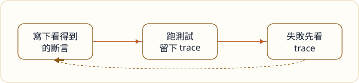

> **範例文章。** 這篇是網站初版的示範內容，用來確認程式碼區塊與頁面包圖片。請直接改寫或刪除。

回歸測試一旦慢到沒人在合併前看，它就不再是回饋，只是事後的報告。Playwright 值得放進這個迴圈，是因為失敗時留下的 trace 通常比一張紅燈截圖更能回答「剛才畫面實際長怎樣」。



## 斷言寫使用者看得到的事

選擇器先用角色與名稱，少靠會跟著改版一起碎掉的 class。下面這段只是在說：列上應該看得到「待出貨」，而不是某個 div 裡有沒有特定字串。

```ts
import { test, expect } from "@playwright/test";

test("待出貨訂單看得到", async ({ page }) => {
  await page.goto("/orders");
  const row = page.getByRole("row", { name: /待出貨/ });
  await expect(row).toBeVisible();
});
```

失敗的時候先打開 trace，確認是資料、權限，還是畫面根本沒渲染。等待時間是最後的手段。先加 `sleep`，通常只是把同一個不穩定的問題往後推。

同一個站上的說明在[歡迎來到卡瑪泰姬]()，文章列表在[這裡](/posts/)。
